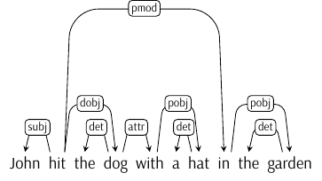
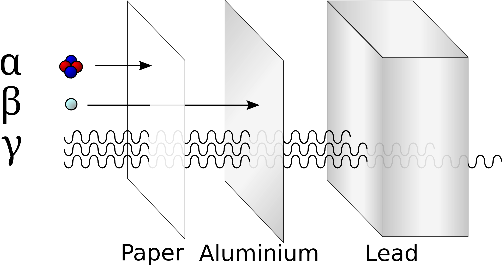

## Previously {.incremental}

* representing language
  * sound
  * sign, including writing
* representing grammar
  * morphology
  
## Today ##

Representing **syntactic** knowledge

# Syntactic knowledge #

## Recall our three questions from earlier on ##

* What does a person know when they know a language?
* How is language acquired?
* How is the knowledge of language used, for instance in speech and understanding?

## More on the knowledge of language ##

Knowledge of language determined by **language faculty** that is

* unique to humans
* innate
    * how to show this?
* only indirectly linked to communication
* irreducible to general cognition

Otherwise we're faced with a logical problem.

## Language faculty is unique to humans ##

Two dimensions to this

  * how good are other animals at mastering human languages?
  * to what extent are the communication systems of other species similar to the human language faculty?
  
We'll deal with some of this in seminar later today.
  
## Language $≠$ communication ##

Communication is one of the *uses* of language but is it really all there is to it?

- we can only understand why language is used the way it is only once we know what it looks like
- this requires the identification of abstract structures of linguistic units

## Language acquisition as a logical problem: _modus ponens_ ##

#### Premise 1 

* Syntax is a productive, recursive and infinite system

#### Premise 2 

* Infinite rule-based systems cannot be learned

#### Conclusion 

* Syntax cannot be learned; *ergo* the existence of syntax means it must be partly already available to the learner *prior* to the start of the learning process.

## Premise 1 ##

:::incremental
* Language is a productive system
    * any speaker of any language can produce and understand expressions (sentences etc.) that they have never heard before
* Language is a recursive system
    * sentences can contain other sentences
        - *Students attend parties*.
        - *I think students attend parties*.
        - *You doubt I think students attend parties*.
        - …
* Language is an infinite system
    * what's the longest sentence?
    * what's the biggest number?
:::

## Premise 2 ##

### Infinite rule-based systems cannot be learned ###

* a baby must transition to an [infinite]{.c1} system based on a [finite]{.c2} set of data
    - e.g. establish correspondences between a sentence and a situation it describes
* let's consider a similar problem in more abstract terms

## Premise 2 

### Infinite rule-based systems cannot be learned ###

| Sentence (input) | Situation (output) |
|--------------------|------------------|
| *x*                | *y*              |
| 1                  | 1                |
| 2                  | 2                |
| 3                  | 3                |
| 4                  | 4                |
| 5                  | 5                |
| 6                  | ?                |

**Problem:** characterise the function mapping *x* to *y*.

## Premise 2 

### Infinite rule-based systems cannot be learned ###

:::incremental
* Obvious answer: *x* = *y* 
    * Consequently, *y* = 6 
* Less obvious answer:
[(*x* − 5) × (*x* − 4) × (*x* − 3) × (*x* − 2) × (*x* − 1)] + *x* = *y*
    * Consequently, *y* = 126
    
:::

::: {.fragment}
To learn a rule, [the entirety of input]{.c1} is necessary.

* But this is technically impossible, since the number of possible sentences is infinite.

:::

## Language acquisition as a logical problem: _modus ponens_ ##

#### Premise 1 

* Syntax is a productive, recursive and infinite system

#### Premise 2 

* Infinite rule-based systems cannot be learned

#### Conclusion 

* Syntax cannot be learned; *ergo* the existence of syntax means it must be partly already available to the learner *prior* to the start of the learning process.

QED

## Looking for regularities ##

 * to describe the structure of an object, we look for regularities
  * applied to the structure of natural-language objects, this entails looking for grammatical regularities
      * to establish the relationships between the parts of a whole, these parts must be **found** and **categorised**
  * every natural-language speaker is capable of distinguishing between sequences of symbols/sounds that are a sentence in that language, and those that are not.

## Word classes ##

Word classes (aka ‘parts of speech’) are an attempt at finding regularities in natural-language expressions.

* traditional definitions familiar from school are unreliable and circular
* instead, formal and distributional criteria are called for
    * such criteria are **deductive** in character

## Formal criteria ##

involve unifying words into classes based on their **form**, i.e. how they **look**.

* **verbs:** *-ed* and its allomorphs
* **nouns:** singular vs. plural forms (*glass -- glasses*; *goose -- geese*)
* **adjectives:** forms of comparison (*tall -- taller -- tallest*)

## Distributional criteria ##

involve unifying words into classes based on their environment.

* **verbs:** cooccurrence with modals (*will, must, could, …*)
* **nouns:** preceded by determiners/articles (*every, the, a*)

## Lexical and functional categories ##

open-class expressions vs. closed-class expressions

**Lexical categories** possess a relatively obvious descriptive content

  * nouns (category N) -- *desk, jacket, solitude, prowess*
  * adjectives (category A) -- *noticeable, yellow, spicy*
  * verbs (category V) -- *attend, run, rejoice*
  
**Functional categories** only carry grammatical meaning

  * determiners/articles (category D) -- *the, each*
  * prepositions (category P) -- *above, in front of, under, behind*
  * complementisers (category C) -- *that, if, whether*
  
## Phrases ##

We have seen that

* words can be strung together into phrases
* those phrases are more than mere sequences of words
* one element inside a phrase is always more prominent that all the others\
$\rightarrow$ **head**\
$\rightarrow$ phrases have internal hierarchical structure

-------------------

To be able to meaningfully talk about natural-language syntax, we must learn to

* determine phrase boundaries
* identify heads inside phrases

# Representing grammatical knowledge

## Dependency grammar

Should be semi-familiar from school (to anyone who went to a Russian school):

::: {style="text-align: center;"}
{ width=40% }
:::

::: {.fragment}
pros: good at capturing morphological relations between heads and dependents

cons: not very good at capturing certain other phenomena and relations 

:::

## Context free grammars ##

(formal grammars whose production rules can be applied to a nonterminal symbol regardless of its context): *A* $\rightarrow$ *α*.

S $\rightarrow$ NP VP\
VP $\rightarrow$ V NP PP\
*etc.*

in linguistics, also known as **phrase-structure grammars**

pros: captures the idea of [lego]{.smallcaps}-blocks familiar from before

cons: too unrestricted (e.g., allows rules like NP $\rightarrow$ VP PP)

## Constituent structure ##

  * **head** (obligatory)
  * dependents (sometimes optional, sometimes obligatory)
      * complements
      * specifiers
      * adjuncts

# Structure-sensitivity of language rules #

## Yes/no-questions in English ##

**Guiding principle**: choose simplest hypothesis consistent with data (aka *Occam's razor*).

**Initial assumption:** *tabula rasa*; no structure

### Data point 1 ###

#. Dave can’t eat chocolate covered almonds.
#. Can’t Dave eat chocolate covered almonds?

### Hypothesis 1 ###

> To form a yes/no question, move the 2nd
word to the front of the sentence.

---------------------

### Hypothesis 1 ###

> To form a yes/no question, move the 2nd
word to the front of the sentence.

### Problem ###

#. The TA can’t eat chocolate covered almonds.
#. \*TA the can’t eat chocolate covered almonds?

$→$ reject/revise Hypothesis 1

---------------------

### Hypothesis 2 ###

> To form a yes/no question move the verb to the
front of the sentence.

#. Dave can’t eat chocolate covered almonds.
#. Can’t Dave eat chocolate covered almonds?
#. The TA can’t eat chocolate covered almonds.
#. \*TA the can’t eat chocolate covered almonds?
#. Can't the TA eat chocolate covered almonds?

---------------------

### Hypothesis 2 ###

> To form a yes/no question move the verb to the
front of the sentence.

### Problem ###

#. The TA ate chocolate covered almonds.
#. \*Ate the TA chocolate covered almonds.

$→$ reject/revise Hypothesis 2

------------------

### Hypothesis 3 ###

> To form a yes/no question move the auxiliary
to the front of the sentence.^[I'm omitting all the previously discussed data, since Hypothesis 3 handles them all effortlessly.]
  
::: {.fragment}
### Problem ###

#. The TA has been eating chocolate covered almonds.
#. \*Been the TA has eating chocolate covered almonds?

$→$ reject/revise Hypothesis 3

:::

------------------

### Hypothesis 4 ###

> To form a yes/no question move the first
auxiliary to the front of the sentence.

::: {.fragment}
### Problem ###

#. The TA who is here can eat chocolate covered almonds.
#. \*Is the TA here can eat chocolate covered almonds?
#. Can the TA who is here eat chocolate covered almonds?

$→$ reject/revise Hypothesis 4
:::

-----------------------

### Hypothesis 5 ###

> To form a yes/no question move [the first auxiliary
after the subject]{.c1} to the front of the sentence.

### Hurrah! ###

  * Finally, we have a *real* rule.
  
## A question for later on ##

Can this rule be induced on the basis of the available evidence alone? 

In other words, does the learner have all the available information to make this generalisation?

## Phrase boundaries ##

How do we know that a certain sequence of words is a phrase, a **constituent**?

* by applying **constituency diagnostics**

How do we represent the structure of phrases/constituents?

* square brackets; syntactic trees

## Constituent structure ##

How do we know if a string's a constituent?

* **if it can be shown to behave as a unit**
* available tests:
    * substitution
    * movement
    * substitution + movement
    * ellipsis
    * clefting
* positive result? $\rightarrow$ we're likely seeing a constituent
* negative result? $\rightarrow$ inconclusive, let's use another test

## In search of constituents: substitution ##

Can the string be replaced by a proform?

* John hit [[ the dog with a hat ]]{.c2} in the garden.
    * John hit [**it**]{.c2} in the garden.

$\rightarrow$ *the dog with a hat* is a constituent

## In search of constituents: ellipsis ##

ellipsis effectively amounts to substitution by a zero (unpronounced) proform

* John hit [[ the dog with a hat ]]{.c2} in the garden…
    * \*and Mary petted [∅]{.c2} in the living room.
	
Negative result! We should try another test.

## In search of constituents: movement ##

Can the string be preposed/fronted?

* [[ The dog with a hat ]]{.c2} John hit in the garden.
   
$\rightarrow$ *the dog with a hat* is a constituent

## In search of constituents: substitution + movement ##

Can the string be replaced by a proform and then fronted/preposed?

* John hit [[ the dog with a hat ]]{.c2} in the garden.
    * [[ Who/what ]]{.c2} did John hit in the garden?

$\rightarrow$ *the dog with a hat* is a constituent

## In search of constituents: clefting ##

Can the string appear inside the *It is/was X that P*?

  *  John hit [[ the dog with a hat ]]{.c2} in the garden.
      *  It was [[ the dog with a hat ]]{.c2} that John hit in the garden.

$\rightarrow$ *the dog with a hat* is a constituent

## In search of constituents: summary ##

* available tests:
    * substitution
    * movement
    * substitution + movement
    * ellipsis
    * clefting
* positive result? $\rightarrow$ we're likely seeing a constituent
* negative result? $\rightarrow$ inconclusive, let's use another test

# Heads and their dependents #

## Asymmetries between words ##

  * words form phrases
  * one element inside a phrase is always more prominent than the others\
$\rightarrow$ **head**\
$\rightarrow$ phrases have  **internal structure**

## Properties of syntactic heads

 * the head bears the central semantic information in the phrase
  * the word class of the head determines the word class of the entire phrase
      * if the head of a phrase is N, then the phrase is a Noun Phrase, or NP
      * similarly for VP, AP, AdvP, PP *etc.*
  * heads are normally obligatory, while other material in a phrase may be optional
  * heads select dependent phrases of a particular word class
      * these phrases are sometimes obligatory, and are known as complements
 
## Familiar example

John hit [[ the dog with a hat ]]{.c2} [[in the garden]]{.c3}

::: {.fragment}

* the **dog** with a hat
* **in** the garden

:::

# More on unboundedness #

## Recall: ‘no longest sentence’ ##

Take any sentence of any length, and add ‘I think’ to the beginning.

  * if necessary, repeat *ad nauseam*

## Linguistic ‘Gamma-rays’ ##

Let's explore a metaphor.

::: {.r-stack}
::: {.fragment .fade-out fragment-index=2}
::: {style="text-align: center;"}
{ width=45% }
:::
:::
::: {.fragment .fade-in fragment-index=2}
What does this have to do with natural-language syntax?

  * questions
  * relative clauses
  * and a few other phenomena we haven't got time for

Wh-movement can cross multiple finite clause boundaries

(@) He was reading **a book**.
(@) **What** was he reading \_\_?

:::
:::

## Unboundedness in questions ##

One clause boundary:

(@) He said [ (that) he was reading **a book**].
(@) **What** did he say [ (that) he was reading \_\_ ]?

-----------------

Two clause boundaries:

(@) She believes [ (that) he said [ (that) he was reading **a book**].
(@) **What** does she believe \
[ (that) he said [ (that) he was reading \_\_ ]]?

-----------------

Three clause boundaries:

(@) They are claiming [ (that) she believes [ (that) he said [ (that) he was reading **a book**]]].
(@) **What** are they claiming [ (that) she believes\
[ (that) he said [ (that) he was reading \_\_ ]]]?

-----------------

Four clause boundaries:

(@) I think [ (that) they are claiming [ (that) she believes\
[ (that) he said [ (that) he was reading **a book**]]]].
(@) **What** do you think [ (that) they are claiming [ (that) she believes \ 
[ (that) he said [ (that) he was reading \_\_]]]]?

------------------

Five clause boundaries:

(@) Everyone agrees [ (that) I think [ (that) they are claiming [ (that) she believes\
[ (that) he said [ (that) he was reading **a book**]]]]].
(@) **What** does everyone agree [ (that) you think [ (that) they are claiming [ (that) she believes \ 
[ (that) he said [ (that) he was reading \_\_]]]]]?

-------------------

Six clause boundaries:

(@) Everyone can hardly deny [ (that) they agree [ (that) I think [ (that) they are claiming [ (that) she believes\
[ (that) he said [ (that) he was reading **a book**]]]]]].
(@) **What** can everyone hardly deny [ (that) they agree [ (that) you think [ (that) they are claiming [ (that) she believes \ 
[ (that) he said [ (that) he was reading \_\_]]]]]?

**Conclusion:** no principled upper bound on the number of clause boundaries wh-movement can cross

## But! ##

Sometimes wh-questions just seem impossible:

(@) a. He made the claim [ that he has met **Wolverine** ] 
	b. \***Who** did he make the claim [ that he has met \_\_]?

(@) a. He mentioned the fact [ that he had run into **Magneto** ]
	b. \*Who did he mention the fact [ that he had run into \_\_]?

::: {.fragment}

Which is particularly striking given the full acceptability of the following:

(@) **Who** did he claim [ that he has met \_\_ ]?
(@) **Who** did he mention [ that he had run into \_\_]?

**What is happening here?**
:::

